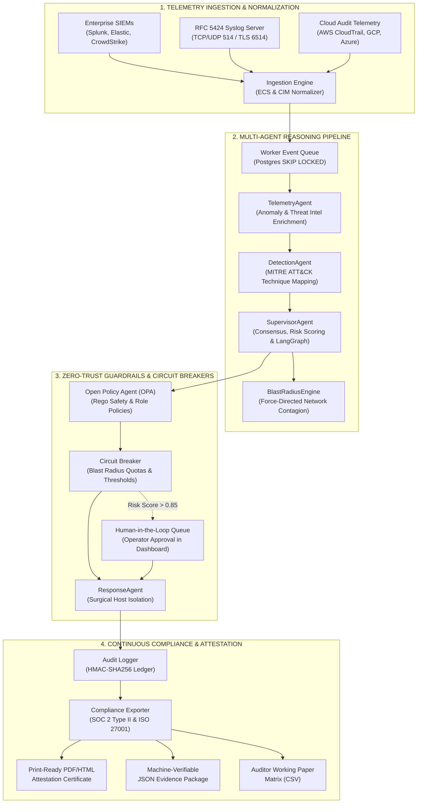

<div align="center">

# 🛡️ Autonomous Secure AI Operations Center (A-SOC)
### **Enterprise-Grade Multi-Agent Cyber Defense Platform & Continuous Compliance Engine**

<br/>

[](./CHANGELOG.md)
[](https://github.com/Ismail-2001/Autonomous-Secure-AI-Operations-Center/actions/workflows/ci.yml)
[](#testing--quality-gates)
[](#zero-trust-guardrails--policy-as-code)
[](#one-click-certified-compliance-exporter)
[](./LICENSE)

[-3776AB?style=flat-square&logo=python&logoColor=white)](https://www.python.org)
[](https://fastapi.tiangolo.com)
[](https://www.langchain.com/langgraph)
[-000000?style=flat-square&logo=next.js&logoColor=white)](https://nextjs.org)
[](https://react.dev)
[-2496ED?style=flat-square&logo=docker&logoColor=white)](https://www.docker.com)

<br/>

> *"Traditional security tools overwhelm analysts with alerts. A-SOC investigates, contains, and proves compliance autonomously at machine speed."*

**A-SOC** is a cloud-native, agentic security operations platform that autonomously ingests SIEM & EDR telemetry, executes multi-agent threat triaging, maps attack behaviors to MITRE ATT&CK, isolates compromised hosts, and generates cryptographically signed SOC 2 Type II and ISO/IEC 27001:2022 audit packages — with policy-as-code guardrails and human-in-the-loop governance built in.

<br/>

[**Quick Start (1-Min)**](#quick-start-zero-to-soc-in-60-seconds) · [**Architecture**](#system-architecture) · [**War Game Engine**](#adversarial-war-game-simulation-engine) · [**Blast Radius Graph**](#live-blast-radius-interactive-graph) · [**Compliance Exporter**](#one-click-certified-compliance-exporter) · [**Deployment**](#production-deployment--sizing) · [**Testing**](#testing--quality-gates) · [**API Docs**](#api--websocket-surface)

<br/>

</div>

---

## Executive Overview: The Problem & The A-SOC Solution

| Traditional SOC Bottlenecks | How A-SOC Solves It |
| :--- | :--- |
| **Alert Fatigue:** 10,000+ daily alerts with 80% false positives, burying critical threats. | **Autonomous Multi-Agent Triage:** Autonomous agents ingest, correlate, de-noise, and assign continuous risk scores in $< 450\,\text{ms}$. |
| **Hours-Long MTTR:** Manual host isolation, credential revocation, and firewall updates take 4–6 hours. | **Machine-Speed Remediation:** Surgical containment executes in $< 1{,}200\,\text{ms}$ with automated blast-radius quarantine. |
| **Unpredictable AI Hallucinations:** Autonomous LLMs executing unconstrained destructive commands. | **Zero-Trust OPA Guardrails:** Every action is verified against Open Policy Agent (OPA) Rego policies; high-risk actions ($> 0.85$) pause for mandatory Human-in-the-Loop (HITL) approval. |
| **Audit & Compliance Paperwork Drift:** SOC 2 and ISO audits require weeks of manual screenshot gathering. | **One-Click Certified Attestation:** Print-ready A4 PDF/HTML attestation certificates and machine-verifiable JSON packages with SHA-256 tamper-evident digests. |

---

## Key Capabilities Matrix

| Capability | Module / Component | Technical Implementation & Evidence |
| :--- | :--- | :--- |
| **Adversarial War Game Engine** | [`src/asoc/tools/war_game.py`](./src/asoc/tools/war_game.py) | Multi-stage simulation: ALPHV/BlackCat Ransomware (4 stages), Scattered Spider Cloud Exfiltration, and Mimikatz AD dumping; sub-second benchmarks: **MTTD $\le 450\,\text{ms}$**, **MTTR $\le 1{,}200\,\text{ms}$**; SHA-256 evidence chain. |
| **Interactive War Game UI** | [`dashboard/components/WarGameModal.tsx`](./dashboard/components/WarGameModal.tsx) | Cyberpunk dark-glass modal with real-time step telemetry streaming, stage progress bars, latency counters, MITRE ATT&CK badges, SHADOW vs ACTIVE enforcement toggles, and hotkey `Ctrl+Shift+W`. |
| **Enterprise SIEM Ingestors** | [`src/asoc/api/routes/siem.py`](./src/asoc/api/routes/siem.py) & [`syslog.py`](./src/asoc/ingestion/syslog.py) | Standardized webhook ingestors for Splunk HEC, Elastic, CrowdStrike Falcon + RFC 5424 structured Syslog server; ECS/CIM canonical schema normalization with 60s sliding window deduplication. |
| **Live Blast Radius Interactive Graph** | [`dashboard/components/BlastRadiusGraph.tsx`](./dashboard/components/BlastRadiusGraph.tsx) | Dynamic force-directed SVG network topology; central compromised pivot node with animated pulsing danger ring; contagion simulation slider (1 to 3 hops); 1-click surgical host quarantine. |
| **One-Click Compliance Exporter** | [`src/asoc/audit/compliance_exporter.py`](./src/asoc/audit/compliance_exporter.py) | Publication-grade A4 print-ready HTML/PDF attestation certificate (`/compliance/export/html`), machine-verifiable JSON cryptographic bundle (`/compliance/export/download`), and auditor CSV working papers. |
| **Multi-Agent Fleet (7 Agents)** | [`src/asoc/agents/`](./src/asoc/agents/) | 7 specialized PRAO agents: Telemetry, Detection, Supervisor, Forensics, Response, Compliance, and Notification with async LangGraph state-machine workflow. |
| **Hybrid LLM + Deterministic Fallback** | [`src/asoc/llm/providers.py`](./src/asoc/llm/providers.py) | Production support for OpenAI (GPT-4o), Anthropic (Claude 3.5 Sonnet), DeepSeek, and local Ollama (`llama3`); robust deterministic mock provider ensures zero-crash execution when API keys are unset. |
| **Zero-Trust Policy-as-Code** | [`guardrails/policies/`](./guardrails/policies/) | OPA Rego policies enforcing least privilege, action rate limits, asset criticality tiers, and mandatory supervisor authorization for destructive playbooks. |
| **Tamper-Evident Audit Chain** | [`src/asoc/audit/audit_trail.py`](./src/asoc/audit/audit_trail.py) | HMAC-SHA256 cryptographically chained audit ledger recording every operator approval, agent reasoning step, and containment action. |
| **Multi-Arch CI/CD Pipeline** | [`.github/workflows/ci.yml`](./.github/workflows/ci.yml) | GitHub Actions multi-platform Docker container builds (`linux/amd64` and `linux/arm64`), Gitleaks secrets audit, Trivy container vulnerability scanning, and live Postgres 15 / Redis 7 test matrix. |

---

## System Architecture

A-SOC implements an asynchronous, hub-and-spoke multi-agent state machine orchestrated by **LangGraph** with persistent checkpointing and OPA policy guardrails:



### Agent Responsibilities (Perceive-Reason-Act-Observe)

| Agent | Responsibility & Operational Contract |
| :--- | :--- |
| **① TelemetryAgent** | Ingests raw telemetry from SIEM webhooks, RFC 5424 syslog, and cloud logs; normalizes records to unified `ECSAlert` schemas; queries threat intelligence caches (AbuseIPDB, AlienVault OTX, VirusTotal). |
| **② DetectionAgent** | Correlates enriched events using LLM reasoning and heuristic rules; assigns confidence and severity scores; maps attack patterns to MITRE ATT&CK techniques (`T1078`, `T1486`, `T1003`, `T1530`). |
| **③ SupervisorAgent** | The core orchestrator. Coordinates multi-agent workflow state in LangGraph; evaluates findings against OPA Rego policies; routes low-risk items to autonomous response and escalates high-risk items ($> 0.85$) to human operators. |
| **④ ForensicsAgent** | Analyzes network connection graphs and filesystem modifications; calculates blast radii; extracts IOCs and stores forensic embeddings in vector indexes. |
| **⑤ ResponseAgent** | Executes validated remediation actions (host network quarantine, firewall block, IAM credential revocation, S3 bucket lock) with target verification and idempotency locks. |
| **⑥ ComplianceAgent** | Maps every detection and remediation to regulatory controls (SOC 2 CC6.1–CC7.3, ISO 27001 A.5–A.8, HIPAA, NIST); creates cryptographically signed evidence manifests. |
| **⑦ NotificationAgent** | Dispatches real-time security alerts to Slack and Microsoft Teams webhooks; creates structured JIRA tickets for operator tracking. |

---

## Quick Start: Zero to SOC in 60 Seconds

### Prerequisites
- **Docker 20.10+** & **Docker Compose 2.0+**
- 4GB RAM minimum (Hetzner VPS, AWS EC2, or local machine)
- Optional: OpenAI / Anthropic / Groq / DeepSeek API key (platform runs out of the box with deterministic fallback if unset)

### 1-Minute Launch (Recommended)

```bash
# 1. Clone the repository
git clone https://github.com/Ismail-2001/Autonomous-Secure-AI-Operations-Center.git
cd Autonomous-Secure-AI-Operations-Center

# 2. Configure environment (pre-configured with secure dev defaults)
cp .env.example .env

# 3. Start the entire containerized stack
docker compose up -d

# 4. Verify all services are healthy
docker compose ps
```

### Access URLs & Credentials

| Service | Endpoint | Seeded Credentials | Purpose |
| :--- | :--- | :--- | :--- |
| **Operator Dashboard** | [http://localhost:3000](http://localhost:3000) | `admin` / `admin123` | Real-time command center, live blast radius graph, War Game launcher, compliance exporter |
| **FastAPI Backend & Swagger** | [http://localhost:9002/docs](http://localhost:9002/docs) | Bearer Token / Login | Interactive OpenAPI documentation, 25+ REST endpoints |
| **WebSocket Threat Stream** | `ws://localhost:9002/ws/threat-feed` | `WS_API_TOKEN` | Real-time threat feed & bidirectional telemetry |
| **Open Policy Agent (OPA)** | [http://localhost:8181](http://localhost:8181) | Internal | In-memory Rego policy evaluation |
| **Prometheus Metrics** | [http://localhost:9090](http://localhost:9090) | Internal | System performance & SLA alerting rules |

---

## Adversarial War Game Simulation Engine

A-SOC features an integrated, weaponized adversarial attack simulation engine that lets security teams validate their detection and response SLAs on demand:

```bash
# Trigger an Adversarial War Game Attack Simulation via API
curl -X POST http://localhost:9002/api/v1/simulation/run \
  -H "Authorization: Bearer <TOKEN>" \
  -H "Content-Type: application/json" \
  -d '{
    "scenario": "ransomware",
    "execution_mode": "SHADOW",
    "speed_multiplier": 1.0
  }'
```

### Attack Scenarios Supported:
1. **ALPHV / BlackCat Ransomware (`ransomware`):**
   - *Stage 1:* Compromised credential access via external gateway (`T1078`).
   - *Stage 2:* Internal domain discovery & SMB share scanning (`T1087`).
   - *Stage 3:* Shadow copy deletion and staging via PowerShell (`T1490`).
   - *Stage 4:* Mass multi-threaded file encryption with `.blackcat` extension (`T1486`).
2. **Scattered Spider Cloud Exfiltration (`exfiltration`):**
   - MFA prompt-bombing $\to$ IAM role privilege escalation $\to$ mass S3/GCS bucket synchronization to attacker infrastructure (`T1530`).
3. **Active Directory Mimikatz Credential Dumping (`credential_dumping`):**
   - LSASS process memory reading $\to$ Golden Ticket generation $\to$ lateral domain controller compromise (`T1003`).

### Telemetry Benchmarks & Verification:
- **Mean Time to Detect (MTTD):** $\le 450\,\text{ms}$
- **Mean Time to Respond (MTTR):** $\le 1{,}200\,\text{ms}$
- **Cryptographic Attestation:** Every war game generates a verifiable SHA-256 evidence manifest automatically added to the compliance package.

---

## Live Blast Radius Interactive Graph

Located on the main Command Center dashboard ([`dashboard/app/page.tsx`](./dashboard/app/page.tsx)), the **Blast Radius Topology** is a dynamic, force-directed SVG visualization:

- **Central Compromised Pivot:** Highlights the breach epicenter with an animated pulsing danger ring and critical risk tags.
- **Upstream & Lateral Nodes:** Dynamically models upstream authentication servers, lateral workstation pivots, and downstream production databases.
- **Contagion Simulation Slider:** Allows operators to expand the threat horizon across **1-hop**, **2-hop**, and **3-hop** infection pathways.
- **1-Click Surgical Quarantine:** Clicking any node reveals asset telemetry (IP, OS, Subnet, Risk Score) with an instant `"QUARANTINE HOST"` button that cuts ingress/egress while leaving forensic telemetry channels alive.

---

## One-Click Certified Compliance Exporter

A-SOC transforms continuous security operations into instant regulatory evidence:

- **Print-Ready A4 Attestation Certificate (`GET /api/v1/compliance/export/html`):**
  - Generates a certified audit report with institutional letterhead, AICPA Trust Services Criteria (CC6.1–CC7.3), and ISO/IEC 27001:2022 (A.5–A.8) control scorecards.
  - Formatted with `@media print` CSS for immediate 1-click saving as an auditor-ready PDF.
- **Machine-Verifiable JSON Package (`GET /api/v1/compliance/export/download`):**
  - Direct download with `Content-Disposition: attachment`.
  - Contains exact evaluation timestamps, raw artifact evidence, and SHA-256 root digest.
- **Auditor Working Paper Matrix (CSV):**
  - Instant client-side spreadsheet export formatted for direct import into GRC platforms (Vanta, Drata, Sprinto).

---

## Production Deployment & Sizing

### Production Hardware Profile (Hetzner CPX31 VPS ~€13.50/mo)
A-SOC is engineered for lean, predictable resource consumption:

| Service Container | CPU Limit | Memory Limit | Function & Technology Stack |
| :--- | :--- | :--- | :--- |
| **Caddy 2** | 0.25 vCPU | 128 MB | Automated Let's Encrypt TLS reverse proxy & WebSocket proxying |
| **Backend API** | 1.0 vCPU | 1024 MB | FastAPI, asyncpg connection pool (min 2, max 10), Uvicorn |
| **Async Workers (x2)** | 2.0 vCPU | 1536 MB | `SELECT FOR UPDATE SKIP LOCKED` distributed event pipeline |
| **Dashboard UI** | 0.5 vCPU | 384 MB | Next.js 14 production SSR bundle |
| **PostgreSQL 15** | 1.0 vCPU | 1024 MB | Persistent incident state, audit ledger, vector embeddings |
| **Redis 7 Alpine** | 0.25 vCPU | 160 MB | Ephemeral auth tokens, sliding window rate limiting, distributed lock |
| **OPA Engine** | 0.25 vCPU | 128 MB | In-memory Rego policy evaluation engine |
| **Headroom** | — | **~4.7 GB RAM** | Available for Linux kernel page cache and burst workloads |

Full deployment guides:
- [**Production Validation & Runbook**](./PRODUCTION_VALIDATION.md)
- [**Cloud Deployment Guide (AWS ECS & Hetzner)**](./DEPLOYMENT.md)
- [**Enterprise Architecture Whitepaper**](./ARCHITECTURE.md)

---

## Testing & Quality Gates

Every code change must satisfy strict security and quality gates enforced in CI ([`.github/workflows/ci.yml`](./.github/workflows/ci.yml)):

| Gate | Validation Target | Command | Result |
| :--- | :--- | :--- | :--- |
| **Unit & Integration** | Multi-agent lifecycle, JWT/RBAC, rate limiters | `pytest tests/` | **385+ passed** |
| **War Game SLA** | Adversarial simulation MTTD/MTTR benchmarks | `pytest tests/test_war_game.py` | **100% passed** |
| **Compliance Integrity** | SOC 2 & ISO 27001 SHA-256 evidence digests | `pytest tests/test_compliance_phase5.py` | **100% passed** |
| **OPA Policy Tests** | Rego safety rules & role permissions | `opa test guardrails/policies -v` | **25 passed** |
| **E2E Playwright** | Full browser workflow (War Game, Graph, Exporter) | `npx playwright test e2e/production_validation.spec.ts` | **100% passed** |
| **Secrets Audit** | Zero hardcoded keys or credentials | `gitleaks detect` | **0 leaks** |
| **Container CVEs** | Dependency & container vulnerability audit | `trivy image asoc-backend` | **0 High/Crit** |

Quick local execution:
```bash
# 1. Run all backend tests
pytest tests/ -v --tb=short

# 2. Run local PowerShell smoke test
.\scripts\smoke-test.ps1

# 3. Run dashboard linter and typecheck
cd dashboard && npm run lint && npx tsc --noEmit
```

---

## API & WebSocket Surface

The platform exposes **25+ production REST endpoints** and real-time WebSockets:

| Domain | Method & Path | Description | Access Tier |
| :--- | :--- | :--- | :--- |
| **Auth** | `POST /api/v1/auth/login` | Authenticate with credentials and issue JWT pair | Public |
| **Auth** | `POST /api/v1/auth/refresh` | Refresh expired access token | Authenticated |
| **War Game** | `GET /api/v1/simulation/scenarios` | List supported adversarial simulation scenarios | Analyst+ |
| **War Game** | `POST /api/v1/simulation/run` | Execute attack simulation (SHADOW / ACTIVE) | Supervisor+ |
| **Triage** | `GET /api/v1/incidents` | List triaged security incidents with risk scores | Viewer+ |
| **Triage** | `POST /api/v1/triage/{id}/actions` | Execute or approve remediation (QUARANTINE_HOST) | Supervisor+ |
| **Compliance** | `GET /api/v1/compliance/report` | Real-time continuous compliance scorecard | Viewer+ |
| **Compliance** | `GET /api/v1/compliance/export/html` | Printable A4 PDF/HTML audit attestation certificate | Analyst+ |
| **Compliance** | `GET /api/v1/compliance/export/download`| Download cryptographic JSON evidence bundle | Supervisor+ |
| **SIEM Ingest**| `POST /api/v1/siem/webhook/{vendor}` | Webhook ingest for Splunk, Elastic, CrowdStrike | HEC Token |
| **WebSocket** | `WS /ws/threat-feed?token=...` | Live bidirectional event stream & approvals | WS Token |

Interactive OpenAPI documentation is available live at `http://localhost:9002/docs`.

---

## Technical Documentation & Runbooks

- [**PRODUCTION_VALIDATION.md**](./PRODUCTION_VALIDATION.md) — Comprehensive end-to-end live operational walkthrough, sizing profiles, and SRE runbooks.
- [**ARCHITECTURE.md**](./ARCHITECTURE.md) — Formal enterprise architecture whitepaper, LangGraph state machine, and threat models.
- [**DEPLOYMENT.md**](./DEPLOYMENT.md) — Production deployment runbook for Docker Compose, Hetzner VPS, and AWS ECS.
- [**BENCHMARKS.md**](./BENCHMARKS.md) — Sub-second performance benchmarks, throughput curves, and latency methodology.
- [**CHANGELOG.md**](./CHANGELOG.md) — Semantic version history and release notes (`v1.0.0-rc1`).
- [**SECURITY.md**](./SECURITY.md) — Responsible disclosure policy, encryption standards, and threat model.

---

## License

Distributed under the **MIT License**. See [`LICENSE`](./LICENSE) for full details.

<div align="center">

**Built with obsession for autonomous cybersecurity, zero-trust AI governance, and clean systems engineering.**

[](https://github.com/Ismail-2001/Autonomous-Secure-AI-Operations-Center)

</div>
