<div align="center">

# 🛡️ Autonomous Secure AI Operations Center (A-SOC)
### **Forward Deployed Engineering (FDE) Operational Platform**
*Autonomous Cyber Defense, Adversarial War Gaming & Machine-Speed Threat Containment*

<br/>

[](https://github.com/Ismail-2001/Autonomous-Secure-AI-Operations-Center/actions/workflows/ci.yml)
[](#operational-verification--quality-gates)
[](#field-deployment-profiles)
[](#5-continuous-compliance--cryptographic-evidence-manifests)
[](#zero-trust-guardrails--safety-doctrine)
[](#mission-sla--latency-benchmarks)
[](./LICENSE)

<br/>

> *"In modern electronic warfare and enterprise cybersecurity, milliseconds separate containment from catastrophe. Traditional SOCs alert humans; A-SOC acts at machine speed under deterministic zero-trust policy."*

[**Mission Brief**](#mission-brief) · [**Field Capabilities**](#forward-deployed-capabilities) · [**System Architecture**](#system-architecture) · [**Deployment Profiles**](#field-deployment-profiles) · [**Verification**](#operational-verification--quality-gates)

<br/>

</div>

---

## Mission Brief

Enterprise Security Operations Centers (SOCs) are structurally overwhelmed by alert volume, operational fatigue, and adversary speed. Sophisticated adversaries (e.g., Scattered Spider, ALPHV/BlackCat) achieve objective completion in under 45 minutes; human analyst queues average 4 to 6 hours for initial triage.

**A-SOC** was designed from the ground up as a **Forward Deployed Engineering (FDE) platform**: an autonomous, multi-agent cyber-defense system deployed directly into hostile or high-compliance environments. It normalizes heterogeneous telemetry, applies collaborative multi-agent reasoning, executes surgical network containment within $\le 1{,}200\,\text{ms}$, and continuously binds every action to a tamper-evident cryptographic compliance ledger.

---

## Forward Deployed Capabilities

```mermaid
flowchart LR
    subgraph INGEST ["1. FIELD RADAR & INGESTION"]
        direction TB
        SIEM["Enterprise SIEM<br/>(Splunk / Elastic / Falcon)"]
        Syslog["RFC 5424 Syslog Receiver<br/>(TLS 6514 / TCP 514)"]
        Cloud["Multi-Cloud Audit<br/>(AWS / GCP / Azure)"]
        Normalizer["ECS / CIM Normalizer<br/>(60s Sliding Dedup)"]
        SIEM --> Normalizer
        Syslog --> Normalizer
        Cloud --> Normalizer
    end

    subgraph REASONING ["2. AUTONOMOUS AGENT CORE"]
        direction TB
        Worker["Async Worker Pipeline<br/>(Postgres SKIP LOCKED)"]
        TelemetryAgent["TelemetryAgent<br/>(Threat Intel Enrichment)"]
        DetectionAgent["DetectionAgent<br/>(MITRE TTP Mapping)"]
        SupervisorAgent["SupervisorAgent<br/>(LangGraph Consensus)"]
        Normalizer --> Worker --> TelemetryAgent --> DetectionAgent --> SupervisorAgent
    end

    subgraph GUARDRAILS ["3. DETERMINISTIC GUARDRAILS"]
        direction TB
        OPA["Open Policy Agent (OPA)<br/>(Rego v1 Security Policies)"]
        CircuitBreaker["Circuit Breaker<br/>(Quota & Blast Limit)"]
        HITL{"Risk > 0.85?<br/>Critical Target?"}
        SupervisorAgent --> OPA --> CircuitBreaker --> HITL
    end

    subgraph CONTAINMENT ["4. SURGICAL ACTION & ATTESTATION"]
        direction TB
        ResponseAgent["ResponseAgent<br/>(Surgical Host Isolation)"]
        Ledger["HMAC-SHA256 Audit Trail<br/>(Tamper-Evident Ledger)"]
        Exporter["Compliance Exporter<br/>(SOC 2 & ISO 27001 PDF/JSON)"]
        HITL -->|Authorized| ResponseAgent
        HITL -.->|Escalate| HumanOp["Operator Console"]
        HumanOp --> ResponseAgent
        ResponseAgent --> Ledger --> Exporter
    end
```



### 1. Ingestion Radar & Canonical Normalization
- **Multi-Vendor SIEM Ingestion:** Dedicated endpoints for **Splunk HEC**, **Elasticsearch**, and **CrowdStrike Falcon** webhooks with HMAC signature validation.
- **RFC 5424 Structured Syslog Receiver:** High-throughput streaming ingest for network switches, firewalls, and bastion nodes.
- **Canonical ECS & CIM Modeling:** Maps raw disparate vendor fields into normalized `ECSAlert` structures with automatic sliding-window deduplication.

### 2. Autonomous Multi-Agent Reasoning (PRAO Lifecycle)
- **7 Coordinated Specialist Agents:** Telemetry, Detection, Supervisor, Forensics, Response, Compliance, and Notification.
- **State Machine with Checkpointing:** Built on **LangGraph** with PostgreSQL persistence. If an agent worker restarts mid-incident, it resumes execution from its exact checkpoint state without duplicate actions.
- **Hybrid Reasoning with Zero-Crash Fallback:** Native support for **Groq**, **DeepSeek**, **OpenAI**, **Anthropic**, and local **Ollama** (`llama3`). A deterministic fallback provider engages when offline, ensuring 100% operational continuity.

### 3. Adversarial War Game Simulation Engine
- **Battle-Tested Scenarios:**
  - `ALPHV / BlackCat Ransomware`: 4-stage adversary progression (Credential Access $\to$ Discovery $\to$ Staging $\to$ Volume Encryption).
  - `Scattered Spider (UNC3944)`: Identity-based cloud exfiltration targeting sensitive S3/GCS buckets.
  - `Mimikatz Credential Dumping`: LSASS process memory extraction on Active Directory Domain Controllers.
- **Execution Modes:** `SHADOW` (passive evaluation and latency tracking) vs `ACTIVE ENFORCEMENT` (live network quarantine).
- **Sub-Second Precision Telemetry:** Mean Time to Detect (**MTTD $\le 450\,\text{ms}$**) and Mean Time to Respond (**MTTR $\le 1{,}200\,\text{ms}$**).

### 4. Live Blast Radius & Interactive Network Topology
- **Dynamic Force-Directed Graph:** Built directly with SVG and mathematical physics simulation without bloated third-party charting libraries.
- **Contagion Hop Expansion:** Interactive 1-hop, 2-hop, and 3-hop infection spread simulation modeling lateral threat movement.
- **One-Click Surgical Host Isolation:** Operators can inspect node health and immediately sever host traffic while preserving forensic volatile memory channels.

### 5. Continuous Compliance & Cryptographic Evidence Manifests
- **Automated SOC 2 Type II & ISO/IEC 27001:2022 Mapping:** Continuous control verification across AICPA Trust Services Criteria (CC6.1–CC7.3) and ISO clauses (A.5–A.8).
- **Printable A4 Attestation Certificate (`.html` / `.pdf`):** Certified auditor letterhead, compliance scorecards, evaluated controls matrix, and verified SHA-256 seal with `@media print` layout.
- **Machine-Verifiable JSON Package:** Downloader endpoint providing complete cryptographic evidence payloads with SHA-256 root digest.
- **Auditor Working Paper Matrix (`.csv`):** Standard tabular export for direct ingestion into Vanta, Drata, or Sprinto.

---

## Mission SLA & Latency Benchmarks

Tested on standard production virtualized hardware (Hetzner CPX31 VPS — 4 vCPU, 8 GB RAM):

| Tactical Metric | Measured SLA (p50) | Measured SLA (p95) | Measured SLA (p99) | Operational Target |
| :--- | :---: | :---: | :---: | :---: |
| **Mean Time to Detect (MTTD)** | **180 ms** | **420 ms** | **680 ms** | $< 1{,}000\text{ ms}$ |
| **Mean Time to Respond (MTTR)** | **480 ms** | **950 ms** | **1,200 ms** | $< 3{,}000\text{ ms}$ |
| **Agent Cycle (Single Hop)** | **20 ms** | **52 ms** | **89 ms** | $< 100\text{ ms}$ |
| **Database Checkpoint Write** | **12 ms** | **28 ms** | **45 ms** | $< 50\text{ ms}$ |
| **API Health & Stats Latency** | **8 ms** | **42 ms** | **68 ms** | $< 100\text{ ms}$ |
| **War Game Containment Efficacy**| **100%** | **100%** | **100%** | **100% Zero Bypass** |

*Methodology, test harnesses, and regression baselines: [`BENCHMARKS.md`](./BENCHMARKS.md).*

---

## Zero-Trust Guardrails & Safety Doctrine

A-SOC enforces a strict **Defense-in-Depth Safety Architecture**:

```
[ Ingested Alert ]
        │
        ▼
[ Supervisor AI Decision ]
        │
        ▼
[ OPA Policy Evaluation ] ───▶ Denied? ──▶ Terminate & Audit Log
        │ Allowed
        ▼
[ Circuit Breaker Quota ] ───▶ Limit Tripped? ──▶ Trip Safety Breaker
        │ Within Quota
        ▼
[ High Risk (Score > 0.85) or Critical DB? ]
       ├── YES ──▶ [ Human-in-the-Loop Operator Authorization ]
       └── NO  ──▶ [ Execute Autonomous Surgical Remediation ]
```

1. **Role-Based Agent Privilege:** Agents are granted strictly partitioned capabilities. The `ComplianceAgent` cannot trigger network isolation; the `ResponseAgent` cannot alter OPA rules.
2. **Policy-as-Code via OPA:** All remediations evaluate against external Rego policies ([`guardrails/policies/`](./guardrails/policies)). Changes to policy require Git review, preventing prompt-injection-driven policy tampering.
3. **Automated Circuit Breaker:** Hard threshold caps prevent run-away automation (max 5 host quarantines within 10 minutes before tripping mandatory operator lock).
4. **Cryptographic Non-Repudiation:** Every action, decision reason, and operator approval is hash-chained via HMAC-SHA256 into PostgreSQL.

---

## Field Deployment Profiles

### Profile 1: Rapid Expeditionary Deployment (Docker Compose)
Ideal for field demonstrations, local evaluation, or single-node edge servers:

```bash
# 1. Clone tactical repository
git clone https://github.com/Ismail-2001/Autonomous-Secure-AI-Operations-Center.git
cd Autonomous-Secure-AI-Operations-Center

# 2. Configure environment (works out of the box with default deterministic mock)
cp .env.example .env

# 3. Launch unified stack
docker compose up -d

# 4. Verify service health
docker compose ps
```

- **Operator Dashboard:** [http://localhost:3000](http://localhost:3000) (Seeded operator: `admin` / `admin123`)
- **Backend API & Swagger:** [http://localhost:9002/docs](http://localhost:9002/docs)
- **Policy Engine (OPA):** `http://localhost:8181`

---

### Profile 2: Tactical VPS Production Profile (Hetzner CPX31 ~€13.50/mo)
Optimized for high-reliability cloud deployment with automated TLS:

```bash
# 1. Start production compose profile with Caddy 2 reverse proxy
docker compose -f docker-compose.prod.yml up -d

# 2. Run automated production smoke tests
pwsh ./scripts/smoke-test.ps1
```

| Service Container | CPU Limit | RAM Allocation | Tactical Role |
| :--- | :---: | :---: | :--- |
| **Caddy 2** | 0.25 vCPU | 128 MB | Automated Let's Encrypt TLS reverse proxy & WSS multiplexer |
| **Backend API** | 1.00 vCPU | 1024 MB | FastAPI, asyncpg pool (min 2, max 10), Uvicorn |
| **Async Workers (x2)** | 2.00 vCPU | 1536 MB | `SELECT FOR UPDATE SKIP LOCKED` distributed event pipeline |
| **Dashboard UI** | 0.50 vCPU | 384 MB | Next.js 15 production SSR bundle |
| **PostgreSQL 15** | 1.00 vCPU | 1024 MB | State checkpointer, audit ledger, vector embeddings |
| **Redis 7 Alpine** | 0.25 vCPU | 160 MB | Ephemeral auth tokens, sliding window rate limits, lock |
| **OPA Engine** | 0.25 vCPU | 128 MB | In-memory Rego policy evaluation |
| **System Headroom** | — | **~4.7 GB RAM** | Linux kernel, file buffers, and page cache |

*Complete multi-cloud production runbook: [`PRODUCTION_VALIDATION.md`](./PRODUCTION_VALIDATION.md) and [`DEPLOYMENT.md`](./DEPLOYMENT.md).*

---

## Operator Console Tour

The Next.js 15 Operator Dashboard provides commanders and Tier-3 analysts with real-time tactical situational awareness:

| Screen / View | Route | Tactical Capability |
| :--- | :--- | :--- |
| **Command Center** | `/` | Real-time threat feed, agent fleet status, live SVG blast-radius graph, quick incident trigger. |
| **Adversarial War Game** | `Modal / Ctrl+Shift+W` | Interactive attack injection (Ransomware/Exfil/Mimikatz), telemetry streaming, latency stopwatch. |
| **Threat Hunting** | `/hunting` | Ad-hoc query console across normalized ECS alerts with technique filtering. |
| **Asset Topology** | `/assets` | Critical asset inventory, quarantine states, and IP subnet mappings. |
| **Forensics** | `/forensics` | Timeline reconstruction, memory dump status, and artifact vector analysis. |
| **Governance & Audit** | `/governance` | Continuous SOC 2 / ISO 27001 scorecards, SHA-256 evidence copy, one-click PDF/JSON/CSV exporters. |

---

## Operational Verification & Quality Gates

Every code change is strictly verified in CI ([`.github/workflows/ci.yml`](./.github/workflows/ci.yml)) across multiple quality gates before deployment:

| Gate | Verification Target | Status |
| :--- | :--- | :---: |
| **Security & Secrets** | Gitleaks secret pattern scan & Trivy container vulnerability scanner | **Zero High/Crit** |
| **Backend Unit & Integration**| 385+ Pytest suites (`pytest tests/`) against live PostgreSQL 15 & Redis 7 | **100% Pass** |
| **Policy-as-Code** | Open Policy Agent evaluation suite (`opa test guardrails/policies -v`) | **25 Passed** |
| **Frontend Static Typing** | Next.js 15 TypeScript validation (`npx tsc --noEmit`) | **0 Errors** |
| **Production Build** | Next.js production SSR bundle compilation (`npm run build`) | **Compiled Clean** |
| **End-to-End Drill** | Playwright test suite (`production_validation.spec.ts`) | **100% Pass** |
| **Multi-Arch Packaging** | Docker build & manifest generation for `linux/amd64` and `linux/arm64` | **Verified** |

To run the full suite locally:

```bash
# Backend test matrix
python -m pytest tests/ -q --cov

# Policy verification (requires opa on PATH)
cd guardrails/policies && opa test . -v && cd ../..

# Frontend lint & build
cd dashboard && npm run lint && npm test && npm run build
```

---

## Repository Architecture

```text
Autonomous-Secure-AI-Operations-Center/
├── .github/workflows/        # Production CI/CD (Multi-arch, Trivy, Gitleaks, E2E)
├── alembic/                  # Database schema migrations
├── core/                     # Backward-compatibility shims
├── dashboard/                # Next.js 15 Operator Console (React 19 + Framer Motion)
│   ├── app/                  # App router pages (Command Center, Governance, Hunting)
│   ├── components/           # BlastRadiusGraph, WarGameModal, AuditExportModal
│   └── e2e/                  # Playwright end-to-end test specifications
├── docs/                     # Formal engineering architecture & design records
├── guardrails/policies/      # OPA Rego security policies & tests
├── k8s/                      # Production Kubernetes manifests & deployment scripts
├── monitoring/               # Prometheus alerting rules, Grafana, Loki configs
├── scripts/                  # Seed, migration & smoke-test validation scripts
├── src/asoc/                 # Autonomous AI Core Platform (Agents, FastAPI, Tools)
│   ├── agents/               # 7 autonomous PRAO agents (Telemetry, Detection, Supervisor...)
│   ├── api/                  # 25+ REST endpoints & WebSocket streams
│   ├── audit/                # Compliance Exporter & HMAC-SHA256 evidence ledger
│   ├── ingestion/            # RFC 5424 Syslog server & SIEM normalizer
│   └── tools/                # War Game Adversarial Simulation Engine
├── tests/                    # 385+ Pytest suites (unit, integration, war game, compliance)
├── .env.example              # Documented configuration variables
├── ARCHITECTURE.md           # Enterprise Architecture Whitepaper
├── PRODUCTION_VALIDATION.md  # End-to-End Walkthrough & Production Runbook
├── DEPLOYMENT.md             # Production Deployment Runbook (Hetzner VPS & AWS ECS)
├── BENCHMARKS.md             # Sub-second latency benchmarks & methodology
├── CHANGELOG.md              # Semantic release notes (v1.0.0-rc1)
├── docker-compose.yml        # Development multi-container stack
├── docker-compose.prod.yml   # Production hardened stack (Hetzner ~€13.50/mo)
├── Dockerfile                # Multi-stage production container image
├── pyproject.toml            # Python packaging & tool configs
├── requirements.txt          # Python dependencies
└── README.md                 # Forward Deployed Engineering Operational Dossier
```

---

## Primary Technical Documentation

| Specification Document | Scope & Tactical Value |
| :--- | :--- |
| **[`PRODUCTION_VALIDATION.md`](./PRODUCTION_VALIDATION.md)** | **End-to-End Live Walkthrough & Production Validation Runbook** — Complete hardware sizing, disaster recovery, and operational procedures. |
| **[`ARCHITECTURE.md`](./ARCHITECTURE.md)** | **Enterprise Architecture Whitepaper** — Multi-agent state machines, LangGraph graph topologies, and fault-tolerance mechanics. |
| **[`DEPLOYMENT.md`](./DEPLOYMENT.md)** | **Deployment Field Manual** — Step-by-step guides for Hetzner CPX31 VPS, AWS ECS Fargate, and Kubernetes. |
| **[`BENCHMARKS.md`](./BENCHMARKS.md)** | **Performance Benchmarks** — Sub-second latency distributions, concurrency thresholds, and hardware test rigs. |
| **[`CHANGELOG.md`](./CHANGELOG.md)** | **Release Notes** — Full version history leading to `v1.0.0-rc1`. |

---

## License

Distributed under the **MIT License** — see [`LICENSE`](./LICENSE).

<div align="center">

**Engineered with obsession for cyber defense, autonomous agents, and mission reliability.**

[](https://github.com/Ismail-2001/Autonomous-Secure-AI-Operations-Center)

</div>
