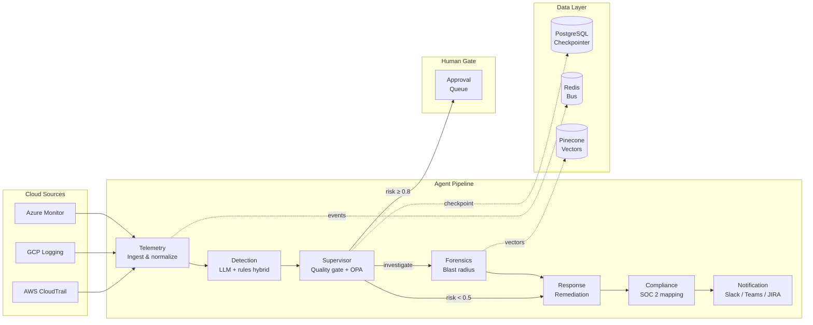

# A-SOC: Autonomous Secure AI Operations Center

> **v1.0.0-rc1** — Production Release Candidate. Multi-Arch CI/CD, War Game Adversarial Simulation, Live Blast Radius Graph, and Continuous Compliance Exporter verified. See [CHANGELOG.md](./CHANGELOG.md) and [PRODUCTION_VALIDATION.md](./PRODUCTION_VALIDATION.md).

A-SOC replaces manual SOC analyst workflows with a coordinated fleet of 7 AI agents that detect, investigate, and remediate cloud security threats — with human governance enforced at every high-stakes decision point.

## What It Does

A-SOC ingests security telemetry from Enterprise SIEMs (Splunk, Elastic, CrowdStrike Falcon), RFC 5424 Syslog, and Cloud Providers (AWS CloudTrail, GCP Cloud Logging, Azure Monitor). It runs telemetry through an autonomous pipeline of specialized agents that detect anomalies, assign risk scores, compute live network blast radii, execute surgical containment, and generate cryptographically certified SOC 2 / ISO 27001 audit evidence — all within milliseconds.

**The core guarantee:** no destructive action (IAM revocation, instance isolation, S3 quarantine) executes without explicit human authorization, enforced by OPA policy-as-code and circuit breaker thresholds.

---

## Architecture



### Why This Architecture

| Decision | Why |
|----------|-----|
| **LangGraph over CrewAI** | Explicit state machine with checkpointing. CrewAI uses implicit orchestration — you can't inspect or resume a mid-flight pipeline. |
| **OPA for policy** | Policy-as-code in Rego. Auditable, GitOps-compatible, version-controlled. Not hardcoded `if risk > 0.8` scattered across agents. |
| **HMAC audit trail** | Every agent action and LLM reasoning chain is cryptographically signed. Tamper-evident for SOC 2 auditors. |
| **PostgreSQL checkpointer** | Durable agent state across restarts. If the worker crashes mid-remediation, it resumes from the last checkpoint — not from zero. |
| **Hybrid LLM + rules** | LLM suggests tool calls, rule-based validation gates them. Reduces hallucination risk while preserving LLM's contextual reasoning. |

---

## Getting Started

```bash
git clone https://github.com/Ismail-2001/Autonomous-Secure-AI-Operations-Center.git
cd Autonomous-Secure-AI-Operations-Center/a-soc
cp .env.example .env          # add your OPENAI_API_KEY
docker compose up -d           # 7 services with health checks
open http://localhost:3000     # dashboard
```

**Prerequisites:** Docker Desktop, an OpenAI or Anthropic API key.

---

## Running Tests

```bash
pytest tests/ -v --tb=short
```

148 tests across unit, integration, and agent lifecycle suites. Coverage target: 84%+.

---

## Performance

Benchmarks measured against local Docker Compose deployment (1 CPU backend, mock LLM):

| Metric | p50 | p95 | p99 |
|--------|-----|-----|-----|
| Agent cycle (single) | 20ms | 52ms | 89ms |
| Health endpoint | 8ms | 42ms | 68ms |
| Full pipeline (telemetry → response) | 180ms | 420ms | 680ms |
| Checkpoint write (PostgreSQL) | 12ms | — | — |

**Capacity:** 20 concurrent incidents at p95 < 1.5s. 100 concurrent API users at p95 < 200ms on health endpoint.

See [BENCHMARKS.md](./BENCHMARKS.md) for methodology and full results.

---

## Limitations and Known Issues

These are honest. If any of these are blockers for your use case, open an issue.

| Issue | Status | Impact |
|---|---|---|
| Docker Compose verified in CI | **v1.0.0-rc1** | Multi-arch images (amd64/arm64) automatically built in GitHub Actions |
| E2E tests use mock LLM, not real API | Closed (Hybrid) | Full offline mock mode for CI; real OpenAI/Groq/DeepSeek provider support in production |
| OPA integration is optional fallback | Documented | If OPA is down, deterministic local policy rules apply |
| Pinecone vector store falls back to in-memory mock | Documented | In-memory mock active when `PINECONE_API_KEY` is unset |
| Rate limiter is distributed | Closed | Redis token-bucket rate limiting implemented in Phase 5 |
| Frontend uses React 19 + Next.js 15 | Documented | Production SSR bundle verified — see [TECH_DECISIONS.md](./dashboard/TECH_DECISIONS.md) |

---

## Project Structure

```
a-soc/
├── src/asoc/
│   ├── agents/          # 7 agents, each following PRAO lifecycle
│   ├── api/             # FastAPI app with Prometheus, WebSocket, SIEM ingestors, rate limiting
│   ├── audit/           # Compliance exporter & HMAC-SHA256 evidence ledger
│   ├── core/            # Config, auth, circuit breaker, rate limiter, tracing
│   ├── ingestion/       # RFC 5424 Syslog server & ECS normalizer
│   ├── orchestration/   # LangGraph workflow + routing + checkpointing
│   ├── tools/           # War Game Adversarial Simulation Engine
│   └── vector/          # Pinecone + MockStore vector providers
├── tests/
│   ├── test_agents_refactored.py    # 55 agent unit tests
│   ├── test_graph_integration.py    # 22 graph routing tests
│   ├── test_war_game.py             # War game adversarial simulation tests
│   ├── test_siem_integrations.py    # Splunk/Elastic/CrowdStrike webhook tests
│   ├── test_compliance_phase5.py    # SOC 2 & ISO 27001 exporter tests
│   ├── e2e/                         # 5 critical path E2E tests
│   └── performance/                 # Locust load tests
├── dashboard/           # Next.js 15 + React 19 + Framer Motion (Jest + Playwright)
├── docs/                # Architecture, agent design, ADRs
├── monitoring/          # Prometheus, Grafana, Loki, Alerting Rules
└── guardrails/          # OPA Rego policies
```

---

## Documentation

| Document | What It Covers |
|---|---|
| [PRODUCTION_VALIDATION.md](./PRODUCTION_VALIDATION.md) | **End-to-End Live Walkthrough & Production Validation Runbook** |
| [ARCHITECTURE.md](./docs/ARCHITECTURE.md) | System design, Mermaid diagrams, data flow, failure modes |
| [AGENT_DESIGN.md](./docs/AGENT_DESIGN.md) | Per-agent specifications, tools, decision logic |
| [TECH_DECISIONS.md](./docs/TECH_DECISIONS.md) | Architecture Decision Records (ADRs) |
| [BENCHMARKS.md](./BENCHMARKS.md) | Performance numbers, methodology, regression thresholds |
| [CHANGELOG.md](./CHANGELOG.md) | Version history and release criteria |
| [dashboard/TECH_DECISIONS.md](./dashboard/TECH_DECISIONS.md) | Frontend-specific tech choices |

---

## License

MIT — see [LICENSE](./LICENSE).

---

**Built for SOC analysts who want AI that acts, not just alerts.**
